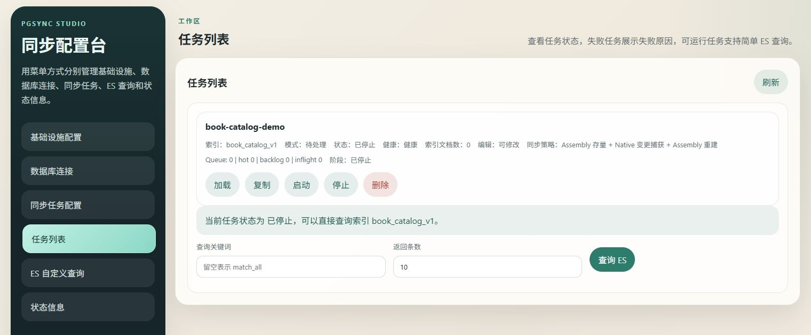

# PGSync Studio

[English](README.md)

[](https://github.com/fooklook/pgsync-studio/actions/workflows/ci.yml)
[](LICENSE)

PGSync Studio 是基于 [PGSync](https://github.com/toluaina/pgsync) 扩展的
PostgreSQL → Elasticsearch 同步平台，提供 Web 配置台、跨库文档组装、
存量与增量同步、故障恢复和运行诊断。

这是独立维护的扩展项目，采用 MIT 许可证，保留上游版权声明，
不代表上游 PGSync 的官方发行版。详见 [UPSTREAM.md](UPSTREAM.md)。

## 保留的能力

- 配置数据源、同步任务、关联关系、软删除和固定过滤条件。
- 支持单库、多表及跨数据库宽文档同步。
- 支持触发器通知、持久化 outbox、Redis 队列、任务租约和补偿扫描。
- 支持 PostgreSQL、配置库及 Redis 短暂故障后的增量任务自动恢复，包含退避重试和租约校验。
- 支持从库读取：批次级 required LSN、回放检查、短暂等待及主库回退。
- 支持按天创建 outbox 分区，并依据保留期和消费者安全水位维护历史分区。
- 提供任务日志、调试信息、ES 查询、别名管理和 Prometheus 指标。
- 提供 `/health/live` 本地恢复线程存活检查，避免依赖服务短暂故障引发容器反复重启。

Studio 数据源目前支持 PostgreSQL；保留的上游 CLI 与 Studio 的能力边界不同。

## 界面预览



截图展示独立的虚构配置预览，任务处于停止状态。
实际存量和跨库增量同步的体验步骤见[图书示例演示](docs/demo.md)（英文），也可按下方命令启动 Compose。

## 本地体验

准备 Docker 和 Compose v2。在本目录执行：

```powershell
Copy-Item .env.example .env
# 先修改 .env 中的 DEMO_POSTGRES_PASSWORD。
docker compose up --build -d --wait
docker compose exec studio python examples/studio/bootstrap_demo.py
```

Linux/macOS 第一条命令使用 `cp .env.example .env`。

浏览器访问 <http://127.0.0.1:8180>。
演示使用独立的 `catalog`、`analytics` 数据库和虚构图书数据，创建
`book_catalog_v1` 任务，组装图书、作者和统计信息。
在 ES 查询页选择该索引并执行 `{"query":{"match_all":{}},"size":10}`。

修改演示数据验证增量同步：

```sh
docker compose exec postgres psql -U studio -d analytics -c "UPDATE book_metrics SET views = views + 1, updated_at = now() WHERE book_id = 1;"
```

命名卷保存任务配置、数据库、Redis 状态和 ES 索引；`docker compose down`
停止容器但保留这些卷。初始化 SQL 仅在 PostgreSQL 数据卷首次创建时执行。

## 部署边界

Nacos 是可选配置源，基础使用不依赖它。数据库账号由服务端环境变量统一注入，
界面只配置主机、端口和数据库；当前版本使用共享源库凭据，
尚不支持在界面为每个数据库单独维护账号。

默认仅通过本机访问控制台。此版本没有内置登录或权限隔离，部署到共享环境时
应放在带认证的反向代理后或受控网络中。演示环境也不对外发布数据库端口。

从库路由和删除维护默认关闭；开启前需要确认主从拓扑、任务配置、
保留期及安全水位。同步采用最终一致性，大批更新和多级关联会影响追平速度。
详细说明见 [部署文档](docs/deployment.md) 和 [安全说明](SECURITY.md)。
自动恢复的适用范围、Redis 持久化要求及 Kubernetes 探针配置见
[任务自动恢复说明](docs/task-auto-recovery.md)（英文）。人工停止的任务不会自动启动；
队列丢失、存量未完成或需要全量重建的任务不承诺自动补齐。

## 开发与测试

Python 3.10+，建议独立虚拟环境，避免与上游 PyPI `pgsync` 同时安装。

```powershell
python -m venv .venv
.venv\Scripts\Activate.ps1
python -m pip install -r requirements/dev.txt
python -m pip install --no-deps -e .
$env:PG_USER = 'studio'
$env:ELASTICSEARCH = 'true'
python -m pytest -q tests/test_studio.py tests/test_studio_metrics.py tests/test_read_replica.py tests/test_nacos_read_replica.py tests/test_studio_recovery.py tests/test_studio_runtime_credentials.py
python tools/check_public_export.py
```

上述单元测试无需真实数据库；其余上游集成测试需要独立测试服务，
参见 [贡献指南](CONTRIBUTING.md)。

## 反馈与上游协作

本扩展的安装、界面、文档组装和维护问题，请提交到
[Studio Issues](https://github.com/fooklook/pgsync-studio/issues)。
建议附上虚构的最小表结构、数据和脱敏日志，便于复现。

Studio 的引擎基础来自 [PGSync](https://github.com/toluaina/pgsync)，
Studio 扩展的运行器和运维机制由本项目独立维护。
上游贡献由上游维护者审核；关系和兼容边界见 [UPSTREAM.md](UPSTREAM.md)。
