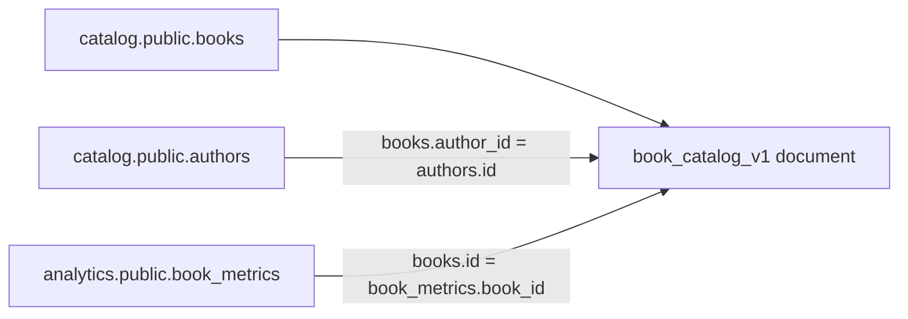
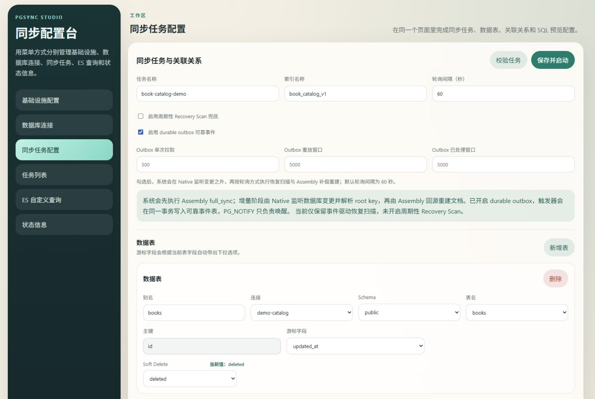

# Book-catalog walkthrough

This disposable Compose example joins PostgreSQL rows into Elasticsearch
documents. It uses synthetic books, authors, and view counters; the same example
runs in the repository's [end-to-end CI](https://github.com/fooklook/pgsync-studio/actions/workflows/ci.yml).

## What it demonstrates

The `book-catalog-demo` job reads `books` and `authors` from `catalog`, and
`book_metrics` from the separate `analytics` database. Both databases live in the
demo PostgreSQL container. The Elasticsearch index is `book_catalog_v1`.



The job first builds a baseline, then uses native change listeners and durable
outbox events to rebuild affected root documents. The automatic check changes a
counter in the second database and a title in the root table, then waits for the
corresponding Elasticsearch values and checks that runner/listener threads are alive.

## Start the example

From the repository root, with Docker and Compose v2 installed:

```sh
cp .env.example .env
# Set DEMO_POSTGRES_PASSWORD in .env before the first start.
docker compose up --build -d --wait
docker compose exec studio python examples/studio/bootstrap_demo.py
```

In PowerShell, replace the first command with `Copy-Item .env.example .env`.
Open <http://127.0.0.1:8180> and select **任务列表** (task list).
Use **加载** (load) to inspect a job's tables and relationships. The current UI
is in Simplified Chinese; the source and setup documentation are available in English.



This screenshot was captured from a local configuration preview using the
checked-in demo schema. Its task is stopped and it does not show live
synchronization results or performance measurements.

## Verify synchronization

Run the same check used by CI:

```sh
docker compose exec studio python tools/smoke_demo.py
```

Expected checkpoints:

```text
PASS baseline assembly
PASS cross-database metric update
PASS root-table update
PASS actual runner and listener threads
```

The script updates only the synthetic Compose example. It increments the first
book's view counter and changes its title, so these values can differ on later runs.
It rejects jobs whose sources do not match the example's container and databases.

For a manual update:

```sh
docker compose exec postgres psql -U studio -d analytics -c "UPDATE book_metrics SET views = views + 1, updated_at = now() WHERE book_id = 1;"
```

In **ES 自定义查询** (custom ES query), select `book_catalog_v1` and submit:

```json
{"query": {"ids": {"values": ["1"]}}, "size": 1}
```

The returned document should contain the changed `book_metrics.views` value.
Synchronization is eventually consistent; this example is a functional check,
not a latency or throughput benchmark.

## Stop and explore further

```sh
docker compose down
```

Named volumes preserve this example's data and configuration. The SQL initializer
runs only on the first creation of the PostgreSQL data volume. Changing `.env`
later does not change an existing PostgreSQL role's password.

Replica reads, cleanup, and partition maintenance are disabled in this example.
They require an appropriate topology and deliberate configuration; see
[deployment and configuration](deployment.md). Protect administrative access
before using a shared environment; see [SECURITY.md](../SECURITY.md).

For Studio feedback, use [the project's issue tracker](https://github.com/fooklook/pgsync-studio/issues)
with a minimal synthetic reproduction. See [UPSTREAM.md](../UPSTREAM.md) for how
this independent extension relates to PGSync.
